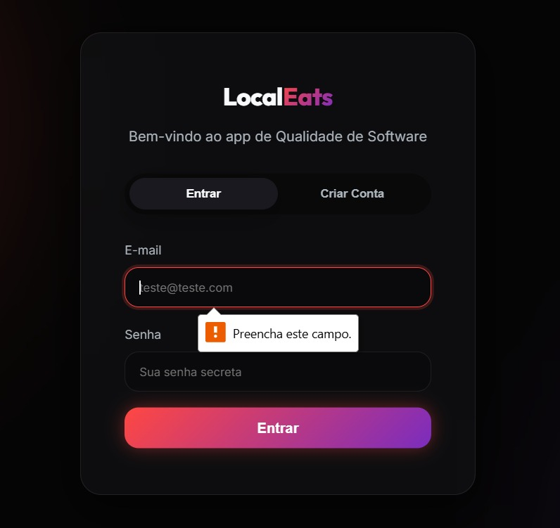
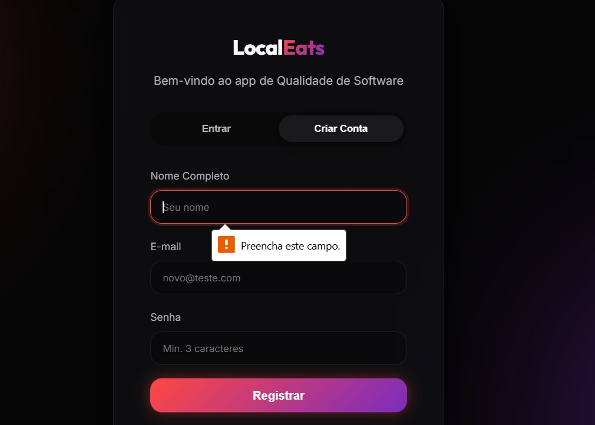

# Atividade 01 — Fundamentos e Características da Qualidade no LocalEats

## 1. Identificação

**Unidade Curricular:** Qualidade de Software  
**Metodologia:** Problem-Based Learning (PBL)  
**Projeto:** LocalEats  
**Integrantes:** Gabriel e William  
**Modalidade:** Dupla

## 2. Contexto analisado

O LocalEats é uma aplicação que conecta usuários a restaurantes locais. Nesta atividade, a dupla analisou os fluxos de entrada no sistema e criação de conta, considerando tanto as funcionalidades declaradas quanto condições de qualidade esperadas pelos usuários.

Aplicação analisada: <https://local-eats-unisenac.vercel.app/>

## 3. Tarefa 1 — Fundamentos da qualidade

### Necessidades explícitas e implícitas

| Tipo | Necessidade | Interessado | Consequência se não for atendida |
|---|---|---|---|
| Explícita | Permitir que o usuário crie uma conta e entre no sistema. | Usuários da aplicação. | Sem acesso, o usuário não consegue utilizar favoritos e pedidos vinculados à conta. |
| Explícita | Permitir pesquisar e filtrar restaurantes por especialidade ou localização. | Usuários e restaurantes cadastrados. | A descoberta dos estabelecimentos fica lenta e pode reduzir a realização de pedidos. |
| Implícita | Proteger credenciais, dados cadastrais e informações de pedidos contra acesso indevido. | Usuários, restaurantes e responsável pelo produto. | Uma falha pode expor dados, permitir o uso indevido de contas e reduzir a confiança no sistema. |
| Implícita | Validar entradas e apresentar mensagens claras em português quando uma ação estiver incompleta ou inválida. | Usuários e equipe de suporte. | A pessoa pode não compreender o erro, repetir tentativas e abandonar a operação. |

### Um sistema que implementa todas as funcionalidades solicitadas pode apresentar baixa qualidade?

Sim. Implementar as funções previstas não garante, por si só, a qualidade do sistema. O LocalEats também precisa proteger os dados, responder de forma confiável e ajudar o usuário a corrigir erros. Nos fluxos observados, o bloqueio de campos vazios funcionou, mas a mensagem em inglês mostra que o requisito funcional precisa ser acompanhado por usabilidade e consistência da interface.

## 4. Tarefa 2 — Exploração da aplicação

| Integrante | Funcionalidade | O que foi realizado | O que foi observado | Evidência |
|---|---|---|---|---|
| Gabriel | Entrar no sistema | **Fluxo esperado:** abrir a tela de login e identificar os campos de e-mail e senha. **Fluxo alternativo:** selecionar **Entrar** com os dois campos vazios, sem utilizar credenciais reais. | O envio foi bloqueado, o foco retornou ao campo de e-mail e o navegador exibiu a mensagem `Please fill out this field.`. A tela de login permaneceu aberta. | [gabriel-login-campos-vazios.jpg](evidencias/gabriel-login-campos-vazios.jpeg) |
| William | Criar conta | **Fluxo esperado:** abrir a aba **Criar Conta** e conferir os campos de nome, e-mail e senha. **Fluxo alternativo:** selecionar **Registrar** com os campos vazios, sem criar uma conta. | O envio foi bloqueado, o campo **Nome Completo** recebeu foco e borda vermelha e apareceu a mensagem `Please fill out this field.`. O campo de senha informa `Min. 3 caracteres`. | [william-cadastro-campos-vazios.jpg](evidencias/william-registro-campos-vazios.jpeg) |

### Evidência de Gabriel — login com campos vazios

### Evidência de William — cadastro com campos vazios

## 5. Tarefa 3 — Requisitos e características de qualidade

| Integrante | Requisito de qualidade | Característica ou subcaracterística | Justificativa | Como avaliar |
|---|---|---|---|---|
| Gabriel | Ao tentar entrar com campos vazios ou credenciais inválidas, o LocalEats deve impedir o acesso e mostrar, junto ao campo ou formulário, uma mensagem clara em português que indique como prosseguir. | **Usabilidade — proteção contra erros do usuário.** | A regra reduz tentativas repetidas e ajuda o usuário a recuperar o fluxo. A evidência mostra que o bloqueio existe, mas a mensagem está em inglês e depende da validação nativa do navegador. | Verificar e-mail vazio, senha vazia e credencial incorreta. Confirmar o bloqueio, a posição da mensagem, o idioma e a orientação apresentada. |
| William | No cadastro, o LocalEats deve rejeitar senhas com menos de três caracteres e aceitar senhas com três ou mais caracteres quando os demais dados forem válidos. | **Adequação funcional — correção funcional.** | O texto do campo comunica um mínimo de três caracteres. A aplicação deve cumprir essa regra de maneira consistente, evitando cadastros inválidos e rejeições indevidas. | Aplicar análise de valor limite com senhas de 2, 3 e 4 caracteres, usando nome e e-mails fictícios válidos. Verificar a rejeição ou aceitação e a mensagem exibida. |

## 6. Uso de inteligência artificial

**Ferramenta utilizada:** ChatGPT, da OpenAI.

**Como foi utilizada:** A ferramenta apoiou a organização das respostas, a revisão da redação e a relação entre cada observação e uma característica de qualidade.

**Como as respostas foram verificadas:** A dupla comparou as respostas com o enunciado e explorou os fluxos de login e cadastro no LocalEats. Cada requisito foi revisado para possuir uma condição observável e uma forma concreta de avaliação.
